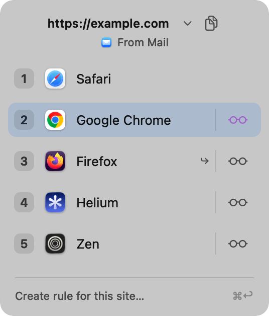

# Eligo

English | [简体中文](README.zh-CN.md)

[](https://github.com/xwaynedx/Eligo/actions/workflows/ci.yml)

Eligo is a native macOS menu bar app that lets you choose which browser opens a web link. It can also route selected domains directly to a configured browser.



## Features

- Browser Chooser for HTTP and HTTPS links.
- Full-link copying, hover and Option previews, a pinnable link popover, and a compact chooser whose width stays stable for its browser list.
- Normal browsing, with Private mode on supported browsers.
- Domain Rules and Routing Scope controls, with rule creation from Settings or the Browser Chooser.
- Rule search, browser filters, and inline destination editing, with destinations grouped by Normal and Private mode.
- Default-browser registration for HTTP and HTTPS.
- Local HTML file handling.
- Browser discovery, ordering, enablement, and custom browser apps.
- English and Simplified Chinese UI.
- Routing settings, language, and optional Launch at Login in General, with setup status and configuration recovery actions.

Private mode is verified on real hardware for Google Chrome, Zen Browser, Helium, and stable Firefox. Brave and Microsoft Edge have declared Private support that is still awaiting real-device verification.

Firefox Nightly retains Normal and Private opening, but is excluded from formal real-device acceptance testing and carries no stability commitment. Other browsers retain Normal opening until a browser-specific Private path is verified.

The real-device checks used ordinary browser configurations. If a Private launch fails, Eligo does not retry the link in Normal mode. Eligo does not detect policies that disable private browsing. A Chromium-based browser subject to such a policy may handle the Private request in its Normal session. Do not rely on Private routing when such restrictions apply.

## Using the chooser and rules

### Inspecting the full link

Hover over the link or hold Option to preview the full URL in a separate popover. Click the expand button to pin it for reading, selecting text, and scrolling through long links. The host is emphasized in bold. The copy button always copies the original full URL, with confirmation inside the popover. When the popover is open, Esc closes it first; press Esc again to cancel the chooser.

### Keyboard controls and routing hints

| Key | Action |
| --- | --- |
| ↑ / ↓ | Move the current selection |
| First letter of a browser name | Cycle through matching browsers |
| 1–9, 0 (without Shift) | Open the corresponding browser's Normal destination (0 selects the tenth browser) |
| Shift + 1–9, Shift + 0 | Open the corresponding browser's Private destination |
| Shift + Return | Open the selected browser's Private destination |
| ⌘Return | Prefill a rule for this site using the currently highlighted destination |

On layouts such as French AZERTY, typing a top-row digit requires Shift, so that key combination requests Private mode. For Normal mode, use the numeric keypad or select the browser with ↑ / ↓ and press Return.

Requesting Private mode for a browser that does not support it plays an alert sound and leaves the chooser open. Tab / Shift + Tab moves focus between controls, and Return activates the focused action. When the chooser itself has focus, Return opens the current selection.

The chooser initially selects the Normal destination of the most recently used browser from a successful manual selection. With Always Show Chooser enabled, a matching Domain Rule or Bypass Destination adds an icon beside its destination. The hint identifies the matched domain, browser, and mode; a bypass target is labeled as the out-of-scope default destination.

### Creating and managing rules

Choose Add Rule… in Settings → Rules, or Create rule for this site… (⌘Return) in the Browser Chooser. The chooser entry prefills the current domain and highlighted destination. After a successful save and editor dismissal, the original link opens once using the saved destination. Canceling the editor or closing Settings returns to the chooser for the original link; later links wait until that link has been handled.

Both entry points use the same rules, with the form and save button explaining the action:

- Reuse an existing rule when the domain, subdomain scope, and destination match. When adding an exact-only rule, if that domain has no exact-only rule but already has a rule including subdomains with the same destination, reuse that rule.
- Explicitly update an existing rule when changing the destination for the same matching scope.
- Expand an existing rule when the domain and destination stay the same and its scope changes from exact-only to including subdomains.
- Keep exact and subdomain rules with different destinations. Exact rules take precedence, and more specific subdomain rules continue to win over broader ones.

Rules supports searching by domain or browser name, filtering by browser, and changing Normal / Private destinations directly in a rule's row. Rules retained for a disabled browser remain searchable by its name, and their destinations keep the browser name with an unavailable label. Edit in the list always edits the selected rule.

### General settings

Settings is divided into General, Browsers, and Rules. General brings together routing settings, language, and Launch at Login. Once setup is complete, it shows a compact ready status that can be expanded for details. If Eligo is no longer the default browser, no browser is available, or the saved configuration cannot be read, it shows the relevant setup or recovery action.

## Requirements

- macOS 15.0 or later.
- Apple Silicon or Intel Mac.
- At least one browser that handles HTTP or HTTPS links.

## Install

Eligo is currently available only as source code. Building the app requires macOS 15 or later and a full Xcode installation with a Swift 6 toolchain. The build script compiles the app icon with `xcrun actool`, which the standalone Command Line Tools do not provide.

1. Clone this repository and enter it:

   ```sh
   git clone https://github.com/xwaynedx/Eligo.git
   cd Eligo
   ```

2. Build, install to `/Applications`, and launch:

   ```sh
   ./script/build_and_run.sh
   ```

   The script ad-hoc signs the bundle and replaces `/Applications/Eligo.app`.

3. Open Settings from the Eligo menu bar icon. In General, click **Set** in the **Default Browser** card to make Eligo the default for HTTP and HTTPS links. You can also choose Eligo in System Settings → Desktop & Dock → Default web browser.

## Development

The project is SwiftPM-based:

```sh
swift build
swift test
```

`./script/build_and_run.sh` (see Install) stages and launches a local `.app` bundle so AppKit and LaunchServices behavior can be exercised correctly. [CONTRIBUTING.md](CONTRIBUTING.md) has the full contributor setup.

For local debugging, use `./script/build_and_run.sh --debug` (or `debug`). It builds and signs the bundle, replaces the installation in `INSTALL_DIR` (default `/Applications`), verifies it, then opens its executable in LLDB. Set a breakpoint with `breakpoint set --name main`, enter `run`, and use `continue` after it stops.

Debug mode adds `com.apple.security.get-task-allow` to a temporary copy of the entitlements and retains Hardened Runtime. The temporary file is removed on exit; rebuilding in `run` or `verify` mode uses the canonical entitlements without the debugging permission. Release builds also use the canonical entitlements.

To use the built bundle in place, set `INSTALL_DIR="$PWD/dist"`. The build step removes any existing `dist/Eligo.app` and assembles a fresh bundle. If the install path resolves to that bundle, including through a relative path or a symlink, installation skips a second deletion and copy. The script attempts to register the new bundle, then launches it or opens it in LLDB according to the selected mode. When installing elsewhere, the script checks the paths after the build. If one bundle is inside the other or either path cannot be resolved, installation stops before replacing the target bundle.

## Release

See the [changelog](CHANGELOG.md) for release contents and [release guide](docs/releasing.md) for the source release process and later Developer ID signing and notarization.

## Privacy

Eligo does not use accounts, analytics, remote telemetry, or a network service. URLs are passed to the browser selected by the user, and preferences are stored locally on the Mac. See [docs/privacy.md](docs/privacy.md).

## Support

Open `About Eligo` from the menu bar and choose `Support Guide`. Use `Copy Support Info` when reporting a problem, then include the steps to reproduce and the browser involved. More troubleshooting guidance is in [docs/support.md](docs/support.md).

## License

Eligo is source-available software distributed under the [Sustainable Use License, Version 1.0](LICENSE).

Personal use, non-commercial use, and use within your own business are permitted, including modifications for those purposes. You may distribute or provide the software to others only free of charge for non-commercial purposes. Selling Eligo or a modified version requires separate permission from the copyright holder. Copies must retain the license and copyright notices, and modified copies must clearly state that they have been modified.
