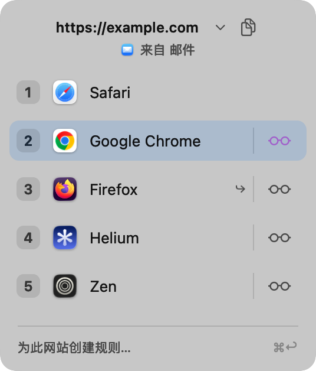

# Eligo

[English](README.md) | 简体中文

[](https://github.com/xwaynedx/Eligo/actions/workflows/ci.yml)

Eligo 是一款原生 macOS 菜单栏应用，让你选择用哪个浏览器打开网页链接，也可以将指定域名自动交给配置好的浏览器。



## 功能

- 通过浏览器选择器打开 HTTP 和 HTTPS 链接。
- 完整链接复制、悬停和 Option 预览、可固定查看的链接浮层，以及宽度随浏览器列表保持稳定的紧凑选择器。
- 可用普通模式打开链接，受支持的浏览器还提供隐私模式。
- 域名规则与路由范围控制，支持从设置或浏览器选择器创建规则。
- 规则搜索、浏览器筛选和行内目标修改，目标菜单按普通与隐私模式分组。
- 注册为 HTTP 和 HTTPS 的默认浏览器。
- 处理本地 HTML 文件。
- 浏览器发现、排序、启用管理，以及添加自定义浏览器应用。
- 英文和简体中文界面。
- 通用设置集中显示路由设置、语言和可选的登录时启动，并提供就绪状态与配置修复入口。

Google Chrome、Zen Browser、Helium 和稳定版 Firefox 的隐私模式已通过实机验证。Brave 和 Microsoft Edge 已声明支持隐私模式，实机验证仍待补充。

Firefox Nightly 保留普通与隐私模式打开能力，但不纳入正式实机验收范围，也不作稳定性承诺。其他浏览器在专用隐私启动方式得到验证前，仅提供普通模式。

上述实机验证使用普通浏览器配置。隐私模式启动失败时，Eligo 不会改用普通模式重试。Eligo 目前不会检测禁用隐私浏览的策略。受此策略限制的 Chromium 系浏览器可能在普通会话中处理隐私模式请求。存在这类限制时，请勿依赖隐私模式路由。

## 使用选择器与规则

### 查看完整链接

将指针停留在链接上，或按住 Option，可在独立浮层中临时预览完整链接。点击展开按钮可固定浮层，停留阅读、选取文字和滚动长链接。主机部分以字重突出显示，复制按钮始终复制原始完整链接，并在浮层内显示复制反馈。浮层打开时，Esc 先关闭浮层；再次按 Esc 才取消选择器。

### 键盘操作与路由提示

| 按键 | 操作 |
| --- | --- |
| ↑ / ↓ | 移动当前选择 |
| 浏览器名称首字母 | 在名称匹配的浏览器之间切换 |
| 1–9、0（不按 Shift） | 打开对应浏览器的普通模式目标（0 对应第十个浏览器） |
| Shift + 1–9、Shift + 0 | 打开对应浏览器的隐私模式目标 |
| Shift + Return | 打开当前所选浏览器的隐私模式目标 |
| ⌘Return | 按当前高亮目标预填本站规则 |

在法语 AZERTY 等键盘布局上，输入顶排数字需要按 Shift，因此该组合键会请求隐私模式。要使用普通模式，可直接按数字小键盘上的数字，或用 ↑ / ↓ 选中浏览器后按 Return。

不支持隐私模式的浏览器会发出提示音并保留选择器。Tab / Shift + Tab 在操作控件间移动焦点，Return 激活聚焦的操作；选择器本身聚焦时，Return 打开当前选择。

选择器初始选中最近一次成功手动选择的浏览器及其普通模式目标。启用“始终显示选择器”后，命中的域名规则或绕过目标会在对应目标旁显示图标；提示信息包含实际匹配的域名、浏览器和模式，绕过目标则标为“范围外默认目标”。

### 创建和管理规则

在“设置 → 规则”中选择“添加规则…”，或在浏览器选择器中选择“为此网站创建规则…”（⌘Return）。选择器入口会预填当前域名和高亮目标；保存成功并关闭编辑器后，原链接按最终保存的目标打开一次。取消编辑或关闭设置窗口会返回原链接的选择器，后续收到的链接等待当前链接处理结束。

两个创建入口使用相同的判断，表单和保存按钮会说明本次操作：

- 域名、子域名范围和目标相同时复用已有规则；添加精确范围规则时，若同一域名尚无精确范围规则，但已有包含子域名且目标相同的规则，则复用后者。
- 相同匹配范围更换目标时，明确更新已有规则的目标。
- 同一域名、同一目标从精确范围扩大到包含子域名时，扩展已有规则。
- 精确范围与包含子域名的规则可以使用不同目标并存，精确规则优先，更具体的子域名规则继续优先匹配。

规则列表支持按域名或浏览器名称搜索、按浏览器筛选，并直接在规则行中更换普通或隐私模式目标。停用浏览器后，其保留规则仍可按浏览器名称搜索，目标会保留名称并标明不可用。列表中的“编辑”始终编辑选中的规则。

### 通用设置

设置分为“通用”“浏览器”和“规则”。通用设置集中显示路由设置、语言与登录时启动；完成设置后显示紧凑的就绪状态，可展开查看设置详情。默认浏览器状态丢失、没有可用浏览器或配置读取失败时，会显示相应的设置或修复入口。

## 系统要求

- macOS 15.0 或更新版本。
- Apple Silicon 或 Intel Mac。
- 至少安装一个能处理 HTTP 或 HTTPS 链接的浏览器。

## 安装

Eligo 目前仅提供源码。构建应用需要 macOS 15 或更新版本，以及带 Swift 6 工具链的完整 Xcode。构建脚本通过 `xcrun actool` 编译应用图标，单独安装的 Command Line Tools 不包含这个工具。

1. 克隆仓库并进入目录：

   ```sh
   git clone https://github.com/xwaynedx/Eligo.git
   cd Eligo
   ```

2. 构建、安装到 `/Applications` 并启动：

   ```sh
   ./script/build_and_run.sh
   ```

   脚本会对应用包进行临时签名，并替换 `/Applications/Eligo.app`。

3. 从 Eligo 菜单栏图标打开“设置”，在“通用”页的“默认浏览器”卡片中点击“设置”，将 Eligo 设为 HTTP 和 HTTPS 链接的默认浏览器。也可以在“系统设置 → 桌面与程序坞 → 默认网页浏览器”中选择 Eligo。

## 开发

项目使用 SwiftPM：

```sh
swift build
swift test
```

`./script/build_and_run.sh`（见“安装”）会组装并启动本地 `.app` 应用包，以便正确运行 AppKit 与 LaunchServices 行为。完整的贡献者环境说明见 [CONTRIBUTING.md](CONTRIBUTING.md)（英文）。

本地调试使用 `./script/build_and_run.sh --debug`（或 `debug`）。脚本会构建并签名应用包，替换 `INSTALL_DIR` 中的安装（默认为 `/Applications`），完成校验后在 LLDB 中打开可执行文件。使用 `breakpoint set --name main` 设置断点，输入 `run` 启动，停下后输入 `continue` 继续。

调试模式会在权限配置的临时副本中加入 `com.apple.security.get-task-allow`，同时保留 Hardened Runtime。临时文件会在退出时删除；以 `run` 或 `verify` 模式重新构建时，使用不含调试权限的原始配置。发布构建也使用原始权限配置。

如需直接使用构建目录中的应用包，设置 `INSTALL_DIR="$PWD/dist"`。构建阶段会删除已有的 `dist/Eligo.app` 并重新组装。安装路径指向新包时（包括等价的相对路径和符号链接），安装阶段会跳过再次删除和复制。脚本随后尝试注册新包，并按所选模式启动应用或在 LLDB 中打开它。安装到其他位置时，脚本会在构建完成后检查路径。若一个应用包位于另一个包内，或任一路径无法解析，安装会在替换目标包前停止。

## 发布

版本内容见[更新日志](CHANGELOG.zh-CN.md)。源码发布流程及后续 Developer ID 签名、公证步骤见[发布指南](docs/releasing.md)（英文）。

## 隐私

Eligo 不使用账号、分析统计、远程遥测或网络服务。链接会交给用户选择的浏览器，偏好设置保存在本机。详情见[隐私说明](docs/privacy.md)（英文）。

## 支持

从菜单栏打开“关于 Eligo”，选择“支持指南”。报告问题时，使用“复制支持信息”，并附上复现步骤及所用浏览器。更多排障说明见[支持文档](docs/support.md)（英文）。

## 许可证

Eligo 是源码公开软件，采用 [Sustainable Use License 1.0](LICENSE) 许可证。

允许个人使用、非商业使用和企业内部办公，也允许为这些用途修改软件。对外分发或提供软件必须免费且用于非商业目的；销售 Eligo 原版或修改版，需要另行获得版权所有者的许可。分发时须保留许可证和版权声明，修改版须明确标注已作修改。
